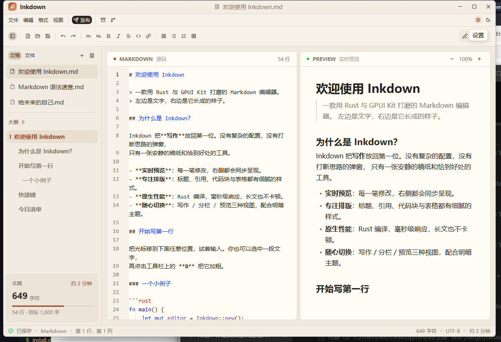

**Inkdown** 是用 Rust + [GPUI Kit](https://gpui-kit.com/zh-CN/) 编写的 Markdown 写作与分发工具：
左边写，右边看；写完可以排版、上传图片、发布到公众号 / 知乎 / 头条 / CSDN / 博客园，
也能放进本地文件夹、做 zip 备份、同步到 Git，并用 AI 辅助写作。

## 本次更新

- **实时视图（所见即所得，`Ctrl + 4`）**：新增第四种视图——整页渲染成
  阅读态：标题放大、Markdown 标记隐藏、代码按语言高亮，与预览完全同款；
  **点击任意块**就地把它的源码换成随内容自动增高的输入框，
  Esc / 点别处 / 失焦立即渲染回所见
  - **智能 Enter**：段落与标题里 `Enter` 在光标处切块、下半成为其后的
    新段落接着写（`Shift + Enter` 块内换行）；代码、列表、引用、表格里
    `Enter` 换行不破坏结构
  - 整块修改在撤销里**只占一步**；实时页同样支持撤销 / 重做
  - 大纲与代码校验的跳转在实时视图内直接滚动定位；空文档自动落下
    占位输入，敲字即开始；阅读态暂不支持框选复制、斜杠面板与图片
    粘贴（写作 / 分栏视图照常可用）
- **修复**：块编辑失焦提交与视图更新重入导致的崩溃；实时视图下撤销
  因编辑器未挂载而落空
- README 新增 linux.do 友链；介绍页两张应用大图改为通栏原生分辨率展示

## 本次发布包含

- **Windows**：`.exe` 安装向导（推荐）与 `.msi`（静默 / 企业部署），均按用户安装、**无需管理员权限**
- **macOS（Apple Silicon）**：`.dmg` 磁盘映像，内含标准 `Inkdown.app`
- **Linux x64**：`.deb` 安装包，自带启动器图标与菜单项
- 三个平台使用同一套新设计的 Inkdown 应用图标
- 详细变更见下方自动生成的提交列表

## 安装

### Windows（推荐 .exe 向导）

下载 `Inkdown-*-windows-x86_64-setup.exe`，双击运行。向导会依次让你选择：

1. **安装位置**（默认 `%LOCALAPPDATA%\Programs\Inkdown`）；
2. **数据存储位置**（备份、默认资源等，默认 `%LOCALAPPDATA%\Inkdown\data`）；
3. **配置存储位置**（`config.json`，默认 `%LOCALAPPDATA%\Inkdown\config`，便于以后单独备份或导入）；
4. 是否**创建桌面快捷方式**（默认勾选）。

全程按当前用户安装，不需要 UAC 提权；开始菜单快捷方式会自动创建。
配置和数据目录会写入安装目录的 `install.json`，升级时保留。

`.msi` 仍然保留给静默安装和软件分发：双击或
`msiexec /i Inkdown-*.msi /qn` 即可，装到 `%LOCALAPPDATA%\Programs\Inkdown`。
`.exe` 与 `.msi` 二选一，不要同时安装两种包。卸载 Setup.exe 版本时只删除程序文件、快捷方式和
`install.json`，数据目录与配置目录会保留，方便重装后继续使用。

> 安装包未做代码签名，若首次运行出现 SmartScreen 提示，点“更多信息 → 仍要运行”即可。

### macOS（Apple Silicon）

打开 `.dmg`，把 **Inkdown.app** 拖入 Applications。应用图标会出现在 Finder 和 Dock。
未做 Apple 公证，首次启动请**右键 → 打开**。

### Linux

```bash
sudo apt install ./Inkdown-*-linux-x86_64.deb
```

安装后启动器里会出现带图标的 Inkdown。

## 功能一览

- **编辑器**：Markdown 语法高亮、行号、软换行、查找、撤销/重做、格式化工具栏与快捷键
- **首屏工作台**：空白文稿直接给出模板、打开文件/文件夹、AI 写作和示例入口
- **斜杠快捷指令**：输入 `/` 插入表格、图片、时间、代码块，打开 AI 对话；支持自定义 JavaScript / Python 命令
- **模板库**：普通文章、技术笔记、周报、会议纪要，`Ctrl + Shift + N` 打开
- **最近文稿**：侧栏记录最近打开的文件，重启后自动恢复上次文稿
- **实时预览**：表格、任务列表、代码块、引用、本地图片、可缩放；**YAML frontmatter 渲染为元数据卡片**
- **代码块语言**：预览代码块多语言语法高亮（约 200 种语法定义），右上角语言按钮可切换 60+ 种语言；
  `/代码块` 插入围栏后直接选语言；语言弹层**可搜索**（中英文名 / 别名），手写别名照样高亮
- **代码校验**：格式菜单「校验代码」或 `/校验` 触发；本地三档 Qwen2.5-Coder 模型
  （可下载、可换目录、离线跑）或设置里的 AI 接口；检测硬件推荐档位，全程明示所用引擎；
  结果可点击跳转，预览角标标问题数；默认关闭
- **预览内查找**：`Ctrl + F` 在预览里高亮并逐条跳转
- **粘贴图片**：截图后 `Ctrl + V` 自动存到 `assets/`（BMP 自动转 PNG），可自动上传图床
- **文档元数据**：`Ctrl + Shift + M` 可视化编辑 frontmatter 字段
- **本地文件夹**：文件树、新建/重命名/删除、拖拽 `.md` 或文件夹进窗口直接打开、空文件夹一键新建
- **图床**：CloudFlare-ImgBed、Lsky Pro
- **发布**：公众号草稿 API、博客园 MetaWeblog，知乎/头条/CSDN/简书/掘金富文本分发
- **AI 写作**：任意 OpenAI 兼容接口，拉取模型、可配置提示词，生成新文档或插入光标
- **AI 对话**：工具栏“询问 AI”或 `/询问ai` 打开对话窗口，多轮历史、可参考当前文稿，
  回复一键插入光标处；与 AI 写作共用设置里的接口配置
- **AI 排版**：格式菜单 / 工具栏魔棒 / `/排版` 唤起，只调排版不动内容，先预览再替换，可撤销
- **实时视图**：`Ctrl + 4` 所见即所得——整页渲染态阅读，点击任意块就地编辑源码，
  智能 Enter 连续写段落，Esc/点别处即渲染；阅读态暂不支持框选复制与斜杠面板
- **启动行为**：设置里三选一——恢复上次文稿 / 打开指定文件 / 新建空白，下次启动生效
- **历史版本**：开关启用后每隔 N 分钟把打开中的文稿（含未保存修改）存为本地 Git 版本，
  「文件 → 历史版本…」预览、恢复，也可手动存版；默认关闭
- **备份与 Git**：zip 备份、保存后自动同步
- **安全退出**：未保存文档关闭前确认；设置改动即时自动保存

## 系统要求

- Windows 10/11 x64；macOS 12+（Apple Silicon）；Ubuntu 22.04+（其他发行版可尝试）
- 首次运行无需额外运行时

## 配置

配置默认保存在：

- Windows：`%APPDATA%\Inkdown\config.json`
- macOS：`~/Library/Application Support/Inkdown/config.json`
- Linux：`~/.config/Inkdown/config.json`

使用 Windows Setup.exe 时，配置文件会写到向导中选择的**配置存储位置**，数据目录也可单独选择；
程序通过安装目录里的 `install.json` 读取这两个路径。环境变量
`INKDOWN_CONFIG_DIR` / `INKDOWN_DATA_DIR` 可覆盖它们，方便便携版或多套配置。

AppID / Token 等密钥以明文保存在本机，请勿提交到公开仓库。
自定义斜杠命令放在配置目录下的 `commands/`，可在 `/` 面板里一键生成模板。

---

## 变更列表
