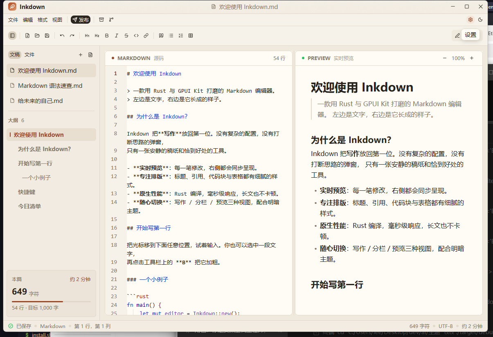

**Inkdown** 是用 Rust + [GPUI Kit](https://gpui-kit.com/zh-CN/) 编写的 Markdown 写作与分发工具：
左边写，右边看；写完可以排版、上传图片、发布到公众号 / 知乎 / 头条 / CSDN / 博客园，
也能放进本地文件夹、做 zip 备份、同步到 Git，并用 AI 辅助写作。

## 本次更新

- **全新应用图标**：圆角纸张 + 印章红标记，Windows EXE / 开始菜单 / MSI、macOS Dock、Linux 启动器统一使用
- **Windows 引导安装**：`Setup.exe` 向导依次选择安装位置、数据目录、配置目录和桌面快捷方式；
  按用户安装，卸载只删程序文件，文稿、备份和配置都保留
- **首屏工作台**：空白文稿直接给出模板、打开文件 / 文件夹、AI 写作和示例入口；空文件夹也能一键新建
- **模板库与最近文稿**：普通文章 / 技术笔记 / 周报 / 会议纪要模板（`Ctrl + Shift + N`）；
  打开过的文件进入侧栏“最近”，重启自动恢复上次文稿
- **斜杠快捷指令**：编辑器输入 `/` 唤起面板，可插入表格、图片、时间、代码块，也能运行
  自己写的 JavaScript / Python 命令（自带示例模板）
- **代码块多语言高亮与语言切换**：预览代码块按围栏语言着色（约 200 种语法定义），
  右上角语言按钮可切换 60+ 种语言；`/代码块` 插入后直接选语言
- **询问 AI 对话窗口**：工具栏“询问 AI”或 `/询问ai` 打开，多轮上下文、可参考当前文稿，
  回复一键插入光标处；与 AI 写作共用设置里的接口配置
- **修复**：双击 debug 版不再弹出多余的 cmd 窗口；斜杠输入不再每个按键复制整篇文档

## 本次发布包含

- **Windows**：`.exe` 安装向导（推荐）与 `.msi`（静默 / 企业部署），均按用户安装、**无需管理员权限**
- **macOS（Apple Silicon）**：`.dmg` 磁盘映像，内含标准 `Inkdown.app`
- **Linux x64**：`.deb` 安装包，自带启动器图标与菜单项
- 三个平台使用同一套新设计的 Inkdown 应用图标
- 详细变更见下方自动生成的提交列表

## 安装

### Windows（推荐 .exe 向导）

下载 `Inkdown-*-windows-x86_64-setup.exe`，双击运行。向导会依次让你选择：

1. **安装位置**（默认 `%LOCALAPPDATA%\Programs\Inkdown`）；
2. **数据存储位置**（备份、默认资源等，默认 `%LOCALAPPDATA%\Inkdown\data`）；
3. **配置存储位置**（`config.json`，默认 `%LOCALAPPDATA%\Inkdown\config`，便于以后单独备份或导入）；
4. 是否**创建桌面快捷方式**（默认勾选）。

全程按当前用户安装，不需要 UAC 提权；开始菜单快捷方式会自动创建。
配置和数据目录会写入安装目录的 `install.json`，升级时保留。

`.msi` 仍然保留给静默安装和软件分发：双击或
`msiexec /i Inkdown-*.msi /qn` 即可，装到 `%LOCALAPPDATA%\Programs\Inkdown`。
`.exe` 与 `.msi` 二选一，不要同时安装两种包。卸载 Setup.exe 版本时只删除程序文件、快捷方式和
`install.json`，数据目录与配置目录会保留，方便重装后继续使用。

> 安装包未做代码签名，若首次运行出现 SmartScreen 提示，点“更多信息 → 仍要运行”即可。

### macOS（Apple Silicon）

打开 `.dmg`，把 **Inkdown.app** 拖入 Applications。应用图标会出现在 Finder 和 Dock。
未做 Apple 公证，首次启动请**右键 → 打开**。

### Linux

```bash
sudo apt install ./Inkdown-*-linux-x86_64.deb
```

安装后启动器里会出现带图标的 Inkdown。

## 功能一览

- **编辑器**：Markdown 语法高亮、行号、软换行、查找、撤销/重做、格式化工具栏与快捷键
- **首屏工作台**：空白文稿直接给出模板、打开文件/文件夹、AI 写作和示例入口
- **斜杠快捷指令**：输入 `/` 插入表格、图片、时间、代码块，打开 AI 对话；支持自定义 JavaScript / Python 命令
- **模板库**：普通文章、技术笔记、周报、会议纪要，`Ctrl + Shift + N` 打开
- **最近文稿**：侧栏记录最近打开的文件，重启后自动恢复上次文稿
- **实时预览**：表格、任务列表、代码块、引用、本地图片、可缩放；**YAML frontmatter 渲染为元数据卡片**
- **代码块语言**：预览代码块多语言语法高亮（约 200 种语法定义），右上角语言按钮可切换 60+ 种语言；
  `/代码块` 插入围栏后直接选语言
- **预览内查找**：`Ctrl + F` 在预览里高亮并逐条跳转
- **粘贴图片**：截图后 `Ctrl + V` 自动存到 `assets/`（BMP 自动转 PNG），可自动上传图床
- **文档元数据**：`Ctrl + Shift + M` 可视化编辑 frontmatter 字段
- **本地文件夹**：文件树、新建/重命名/删除、拖拽 `.md` 或文件夹进窗口直接打开、空文件夹一键新建
- **图床**：CloudFlare-ImgBed、Lsky Pro
- **发布**：公众号草稿 API、博客园 MetaWeblog，知乎/头条/CSDN/简书/掘金富文本分发
- **AI 写作**：任意 OpenAI 兼容接口，拉取模型、可配置提示词，生成新文档或插入光标
- **AI 对话**：工具栏“询问 AI”或 `/询问ai` 打开对话窗口，多轮历史、可参考当前文稿，
  回复一键插入光标处；与 AI 写作共用设置里的接口配置
- **备份与 Git**：zip 备份、保存后自动同步
- **安全退出**：未保存文档关闭前确认；设置改动即时自动保存

## 系统要求

- Windows 10/11 x64；macOS 12+（Apple Silicon）；Ubuntu 22.04+（其他发行版可尝试）
- 首次运行无需额外运行时

## 配置

配置默认保存在：

- Windows：`%APPDATA%\Inkdown\config.json`
- macOS：`~/Library/Application Support/Inkdown/config.json`
- Linux：`~/.config/Inkdown/config.json`

使用 Windows Setup.exe 时，配置文件会写到向导中选择的**配置存储位置**，数据目录也可单独选择；
程序通过安装目录里的 `install.json` 读取这两个路径。环境变量
`INKDOWN_CONFIG_DIR` / `INKDOWN_DATA_DIR` 可覆盖它们，方便便携版或多套配置。

AppID / Token 等密钥以明文保存在本机，请勿提交到公开仓库。
自定义斜杠命令放在配置目录下的 `commands/`，可在 `/` 面板里一键生成模板。

---

## 变更列表
