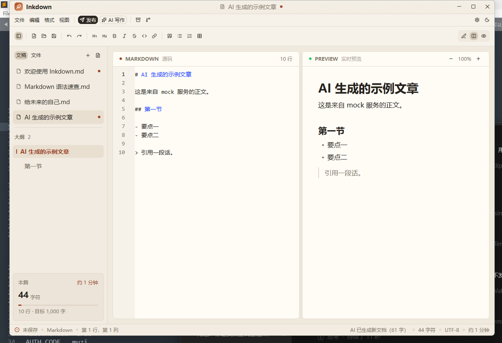

# Inkdown

[](https://github.com/ice-a/inkdown/actions/workflows/build.yml)

用 Rust + [GPUI Kit](https://gpui-kit.com/zh-CN/) 编写的 Markdown 写作与分发工具。
左边是文字，右边是它长成的样子；写完可以排版、上传图片、发布到公众号 / 知乎 / 头条 / CSDN / 博客园等平台，
也能把文稿放进本地文件夹、做 zip 备份并同步到 Git。


## 功能

- **编辑器**：Markdown 语法高亮、行号、软换行、内置查找、撤销/重做、格式化工具栏与快捷键。
- **实时预览**：Markdown 渲染、表格、任务列表、代码块、引用、本地图片；可缩放。
- **主题**：暖纸浅色 / 墨夜深色，主题选择会记住。
- **文稿管理**：示例文稿、标签页式文稿列表、目录大纲（点击跳转编辑器并定位预览）。
- **本地文件夹**：打开文件夹、文件树、新建 / 重命名 / 删除文件与文件夹、刷新、在文件管理器中显示。
- **图床**：CloudFlare-ImgBed、Lsky Pro；发布前自动上传本地图片并改写 Markdown 源码。
- **AI 写作**：任何 OpenAI 兼容接口（OpenAI、DeepSeek、Moonshot、Ollama、LM Studio、自建网关），
  可配置 Base URL / API Key / 提示词，一键拉取模型列表选择，生成新文档或插入当前光标处。
- **发布**：公众号草稿 API、博客园 MetaWeblog、知乎/头条/CSDN/简书/掘金“复制富文本 + 打开发布页”。
- **公众号排版**：内联样式 HTML，代码块、表格、引用、任务列表都有专门样式；外链可自动转文末参考列表。
- **备份**：一键把当前文件夹（或未保存文稿）打包成 zip；可设置保存后自动备份。
- **Git**：初始化仓库、提交、拉取、推送、保存后自动同步；使用系统 git 与凭据管理器。

## 环境要求

- Windows 10/11（本项目主要在 Windows 上开发；GPUI Kit 也支持 macOS/Linux）。
- Rust **1.92+**（MSVC toolchain）。
- Visual Studio 2022 Build Tools / Community，勾选“使用 C++ 的桌面开发”（MSVC + Windows SDK）。
- CMake（GPUI 构建需要）。
- Git（仅 Git 同步功能需要）。
- 能访问 crates.io 的网络（首次编译）。

## 运行

```bash
cargo run
```

首次编译需要下载并编译 GPUI 相关依赖，耗时较长；之后增量编译会快很多。发布版本：

```bash
cargo build --release
./target/release/inkdown
```

## 快捷键

| 操作 | 快捷键 |
| --- | --- |
| 新建文档 | `Ctrl + N` |
| 打开 Markdown | `Ctrl + O` |
| 打开文件夹 | `Ctrl + Shift + O` |
| 保存 / 另存为 | `Ctrl + S` / `Ctrl + Shift + S` |
| 导出 HTML | `Ctrl + Shift + E` |
| 发布中心 | `Ctrl + Shift + P` |
| AI 写作 | `Ctrl + Shift + A` |
| Git 同步 | `Ctrl + Shift + G` |
| 加粗 / 斜体 / 行内代码 / 链接 | `Ctrl + B` / `Ctrl + I` / `Ctrl + E` / `Ctrl + K` |
| 写作 / 分栏 / 预览视图 | `Ctrl + 1` / `Ctrl + 2` / `Ctrl + 3` |
| 切换主题 / 侧边栏 | `Ctrl + Shift + T` / `Ctrl + Shift + B` |
| 关闭弹层 | `Esc` |

## AI 写作



设置 → **AI 写作**：

| 字段 | 说明 |
| --- | --- |
| Base URL | OpenAI 兼容服务地址，需包含 `/v1`，如 `https://api.openai.com/v1`、`https://api.deepseek.com/v1`、本机 Ollama 的 `http://127.0.0.1:11434/v1` |
| API Key | `Authorization: Bearer` 使用，只保存在本机配置文件 |
| 模型 | 手动填写，或点 **拉取模型** 从 `GET {base}/models` 读取后从下拉中选择 |
| 提示词 | 作为 system 消息发送，决定文章的身份、结构与输出格式 |

用法：菜单栏 **AI 写作** 按钮（或 `Ctrl + Shift + A`）打开弹层 →

1. 填写主题/要求（越具体越好：主题、字数、读者、语气）；
2. 可选打开 **参考当前文档**，把当前文稿（最多 6000 字）作为上下文，用于续写、改写、扩写；
3. **生成新文档** 打开一个以文章标题命名的新文稿；**插入光标处** 把结果拼接进当前文档
   （选中了一段文字则替换选中内容，`Ctrl + Z` 可整体撤销）。

接口走 `POST {base}/chat/completions`（非流式）。生成结果会先显示在弹层日志里，
再去掉模型偶尔包裹的 ```` ```markdown ```` 围栏后写入文稿。

## 发布平台说明

| 平台 | 方式 | 需要准备 |
| --- | --- | --- |
| 微信公众号 | 官方草稿箱 API | 认证公众号、AppID/AppSecret、后台 IP 白名单；文章至少有一张图（作为封面），或在设置里填默认封面 |
| 博客园 | MetaWeblog API | 博客园用户名 + MetaWeblog 访问令牌（设置 → 其他设置） |
| 知乎 / 今日头条 / CSDN / 简书 / 掘金 | 富文本复制 + 打开发布页 | 浏览器里已登录对应平台；打开页面后 `Ctrl + V` 粘贴 |
| 任意富文本编辑器 | “只复制排版” | 无 |

为什么不做知乎/头条/CSDN 的全自动提交？这些平台没有公开的文章发布 API，
Cookie/接口逆向方案会随前端改版失效，也可能触发风控。Inkdown 选择稳定、不接触账号密码的方式：
公众号和博客园走官方接口，其余平台把排版好的富文本放进剪贴板并打开发布页。
公众号草稿创建成功后会打开公众号后台，仍需人工确认后群发——这也是微信官方接口的边界。

公众号正文中的外链会被微信移除，因此默认开启“外链转参考”，在文末生成参考链接列表。
封面会优先使用文章第一张图片；没有图片时读取设置里的“默认封面”绝对路径。

## 图床

设置 → 图床：

- **CloudFlare-ImgBed**：填站点根地址，如 `https://img.example.com`；上传认证码填 `authCode`，
  也可以填 API Token（`Authorization: Bearer ...`）。请求 `POST {base}/upload?returnFormat=full`。
- **Lsky Pro**：填站点根地址和 API Token，请求 `POST {base}/api/v1/upload`。

发布时勾选“上传本地图片到图床”，Inkdown 会扫描 Markdown 与 HTML 中的本地图片，
上传后把源码里的相对路径替换为图床 URL。公众号发布还会把图片额外上传到微信素材库，
并用第一张图创建封面素材。

## 本地文件夹 / 备份 / Git

- **打开文件夹**：文件 → 打开文件夹，或侧边栏“文件”页签。只展示 Markdown 文件，
  自动跳过 `.git`、`node_modules`、`target` 等目录。
- **备份**：菜单栏的归档按钮，或 文件 → 立即备份。默认写入
  `%APPDATA%\Inkdown\backups`，可在设置里改目录。备份包含当前文件夹的文稿和资源。
- **Git**：设置里填远端、分支、用户名/邮箱，点击“初始化仓库”后即可“立即同步”。
  同步流程是 `git add -A` → 有改动则 commit → `pull --rebase` → `push -u origin <branch>`。
  用户名/密码交给系统 Git 凭据管理器；Inkdown 设置 `GIT_TERMINAL_PROMPT=0`，不会在后台等待输入密码。
  也可以开启“保存后自动同步”。

## 配置文件

配置文件位置：

```
%APPDATA%\Inkdown\config.json
```

AppID/AppSecret/Token 等密钥以**明文**保存在本机配置文件中，请勿把该文件提交到公开仓库。
设置面板底部会显示配置文件路径。

## 项目结构

```
src/
  main.rs       应用启动、窗口、快捷键
  app.rs        主视图、编辑器/预览、侧边栏、弹层、动作处理
  actions.rs    所有命令动作
  doc.rs        文档模型、示例文稿、大纲、统计、HTML 导出
  theme.rs      浅色/深色配色
  ui.rs         设置/发布表单状态
  workspace.rs  文件夹文件树与扫描
  publish.rs    内联样式 HTML、公众号接口、博客园接口、剪贴板
  ai.rs         OpenAI 兼容接口：拉取模型、chat/completions 生成
  imagebed.rs   CloudFlare-ImgBed / Lsky Pro 上传
  backup.rs     zip 备份
  git.rs        系统 git CLI 封装
  config.rs     配置持久化
  widgets.rs    小部件
```

## 测试

```bash
cargo test
```

当前覆盖：富文本渲染、图片扫描与本地路径解析、图床 multipart 上传（本地 mock HTTP 服务）、
AI 拉取模型 + chat/completions 生成（本地 mock HTTP 服务）、Markdown 围栏清理、
文件树扫描、zip 备份、Git 初始化/提交/推送到本地裸仓库。

## 已知限制

- 没有做“关闭窗口前确认未保存”，请养成 `Ctrl + S` 的习惯。
- 公众号 API 只能创建草稿，最终发布需要在公众号后台确认；个人订阅号没有该接口权限。
- 知乎/头条/CSDN 等平台需要人工粘贴；一次选择多个平台会打开多个标签页。
- 本地图片会原样上传，暂不做压缩或格式转换。
- 首次编译 GPUI 依赖较慢；发布版请使用 `--release`。
