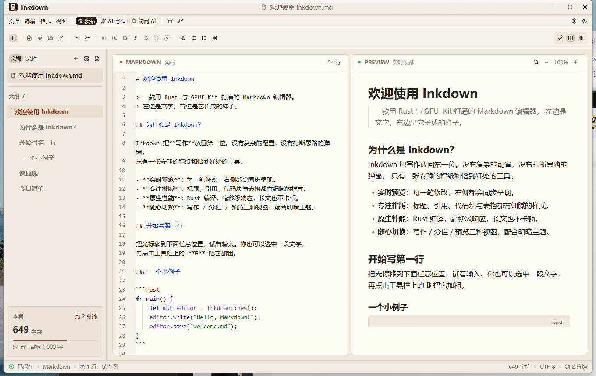
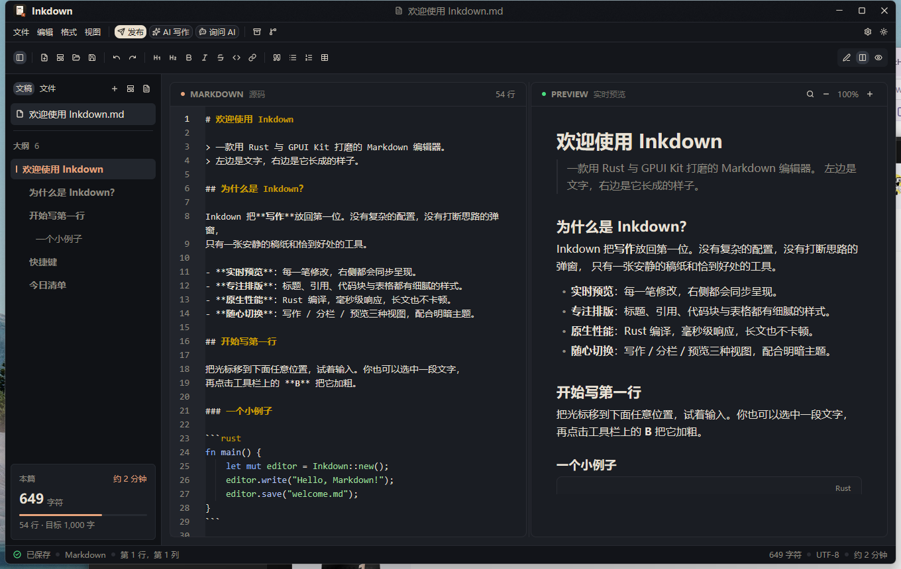
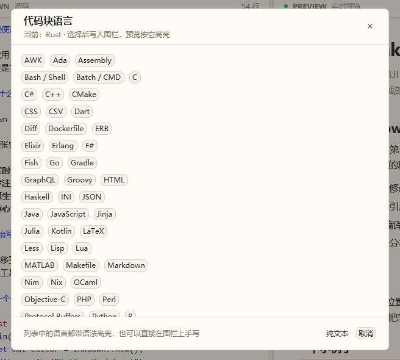
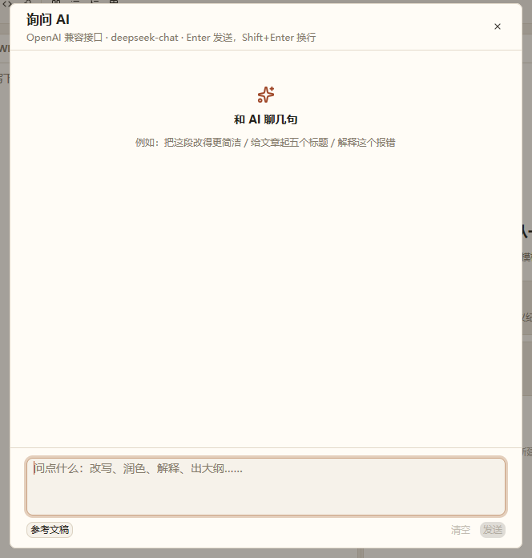

<div align="center">
  
</div>

<h1 align="center">Inkdown · 墨笺</h1>

<p align="center">本地优先的 Markdown 写作与分发工具：左边写，右边看。</p>

<p align="center">
  <a href="https://github.com/ice-a/inkdown/releases/latest"></a>
  <a href="https://github.com/ice-a/inkdown/actions/workflows/build.yml"></a>
  <a href="https://github.com/ice-a/inkdown/releases"></a>
</p>

<p align="center">
  <a href="#下载">下载</a> ·
  <a href="https://github.com/ice-a/inkdown/releases">Releases</a> ·
  <a href="https://github.com/ice-a/inkdown/issues">Issues</a>
</p>

## 两种样子

左半边是文字，右半边是它长成的样子。浅色是暖纸，深色是墨夜，选择会被记住。

| 暖纸 | 墨夜 |
| :-: | :-: |
|  |  |

## Markdown 文件，不该被 Markdown 拖慢

- **本地优先**：文稿就是磁盘上的 `.md` 文件，没有私有数据库、没有账号、没有需要登录的同步服务；
- **随时带走**：文件夹即工作区，换台电脑用任何编辑器都能接着写；
- **不只是预览器**：编辑、排版、发布在同一条流水线上，写完可以直接发到公众号、知乎、头条；
- **为长文准备**：Rust 编译，实时预览跟得上输入，几万字也不拖沓。

## 它能做什么

### 写作与排版

- Markdown 语法高亮、行号、软换行、内置查找、撤销 / 重做，格式化工具栏与快捷键；
- 写作 / 分栏 / 预览三种视图：`Ctrl + 1`、`Ctrl + 2`、`Ctrl + 3`；
- 实时预览：表格、任务列表、代码块、引用、本地图片，可缩放；
- YAML frontmatter 渲染为元数据卡片，统计与发布时自动排除元数据；
- 模板库：普通文章、技术笔记、周报、会议纪要，`Ctrl + Shift + N` 打开；
- 截图后直接 `Ctrl + V`，图片自动存到文档旁的 `assets/`（BMP 自动转 PNG）并插入链接。

### 代码与技术内容

- 围栏代码块按语言着色，内置约 200 种语法定义；
- 每个代码块右上角有语言按钮，可切换 60+ 种常用语言；选中后直接改写围栏，预览立刻生效；
- `/代码块` 插入围栏后直接打开语言列表。



### 整理与查找

- 本地文件夹：文件树、新建 / 重命名 / 删除，拖拽 `.md` 或文件夹进窗口直接打开；
- 目录大纲跟随光标，点击跳转编辑器并定位预览；
- 最近文稿：打开过的文件进入侧栏，重启后回到上次编辑的文稿；
- 预览内查找：`Ctrl + F` 高亮所有匹配并逐条跳转。

### 发布与分发

- 公众号草稿箱 API：内联样式排版，代码块、表格、引用、任务列表都有专门样式；
- 博客园 MetaWeblog；知乎 / 今日头条 / CSDN / 简书 / 掘金“复制富文本 + 打开发布页”；
- 图床：CloudFlare-ImgBed、Lsky Pro，发布前自动上传本地图片并改写源码；
- 公众号的外链自动转成文末参考列表，贴合微信的排版限制。

### AI 辅助

- **AI 写作**：任意 OpenAI 兼容接口（OpenAI、DeepSeek、Moonshot、Ollama、LM Studio、自建网关），
  可配置 Base URL / API Key / 提示词，一键拉取模型列表，生成新文档或插入光标；
- **询问 AI**：工具栏按钮或 `/询问ai` 打开对话窗口，多轮上下文、可参考当前文稿，
  回复一键插入光标处；对话里 `Enter` 发送、`Shift+Enter` 换行；
- 两者共用设置里的同一套接口配置。



### 斜杠快捷指令

- 输入 `/` 打开命令面板：插入表格、图片、时间、代码块，或打开 AI 对话；
- 自定义命令：把 `.js` / `.mjs` / `.cjs` / `.py` 放进配置目录的 `commands/`，面板里一键生成模板；
- 脚本从 stdin 读取当前文稿、选中文字、光标位置和查询词，把要插入的 Markdown 写到 stdout。

## 下载

| 平台 | 安装包 | 说明 |
| --- | --- | --- |
| Windows x64 | `.exe`（推荐） | 安装向导，可选安装位置、数据目录、配置目录和桌面快捷方式 |
| Windows x64 | `.msi` | 静默 / 企业部署 |
| macOS（Apple Silicon） | `.dmg` | 内含标准 `Inkdown.app` |
| Linux x64 | `.deb` | 自带启动器图标与菜单项 |

全部按用户安装，Windows 两个包都无需管理员权限；`.exe` 与 `.msi` 二选一，不要同时安装。

## 安装

### Windows

下载 `Inkdown-*-windows-x86_64-setup.exe` 双击运行。向导会依次让你选择：

1. **安装位置**（默认 `%LOCALAPPDATA%\Programs\Inkdown`）；
2. **数据存储位置**（备份等，默认 `%LOCALAPPDATA%\Inkdown\data`）；
3. **配置存储位置**（`config.json`，默认 `%LOCALAPPDATA%\Inkdown\config`）；
4. 是否**创建桌面快捷方式**。

选择会写入安装目录的 `install.json`，程序按它读取配置和数据。卸载只删除程序文件、快捷方式和
`install.json`，文稿、备份和配置都会保留。安装包未做代码签名，SmartScreen 提示时
点“更多信息 → 仍要运行”即可。

### macOS

打开 `.dmg`，把 **Inkdown.app** 拖入 Applications。未做 Apple 公证，首次启动请右键 → 打开。

### Linux

```bash
sudo apt install ./Inkdown-*-linux-x86_64.deb
```

## 快捷键

| 操作 | 快捷键 |
| --- | --- |
| 新建文档 | `Ctrl + N` |
| 从模板新建 | `Ctrl + Shift + N` |
| 打开 Markdown | `Ctrl + O` |
| 打开文件夹 | `Ctrl + Shift + O` |
| 保存 / 另存为 | `Ctrl + S` / `Ctrl + Shift + S` |
| 导出 HTML | `Ctrl + Shift + E` |
| 发布中心 | `Ctrl + Shift + P` |
| AI 写作 | `Ctrl + Shift + A` |
| 斜杠快捷指令 | 输入 `/`；`↑` / `↓` 选择，`Enter` / `Tab` 执行，`Esc` 关闭 |
| Git 同步 | `Ctrl + Shift + G` |
| 加粗 / 斜体 / 行内代码 / 链接 | `Ctrl + B` / `Ctrl + I` / `Ctrl + E` / `Ctrl + K` |
| 写作 / 分栏 / 预览视图 | `Ctrl + 1` / `Ctrl + 2` / `Ctrl + 3` |
| 切换主题 / 侧边栏 | `Ctrl + Shift + T` / `Ctrl + Shift + B` |
| 关闭弹层 | `Esc` |

## 数据与隐私

- 文稿、备份、配置都在你自己的磁盘上，Inkdown 不上传、不收集；
- AppID / Token 等密钥以**明文**保存在本机 `config.json`，请勿把该文件提交到公开仓库；
- 自定义命令以当前用户权限运行，可以访问文件和网络，只运行你信任的脚本。

## 配置

默认配置位置：

```
Windows: %APPDATA%\Inkdown\config.json
macOS:   ~/Library/Application Support/Inkdown/config.json
Linux:   ~/.config/Inkdown/config.json
```

用 Setup.exe 安装时，配置文件写到向导中选择的**配置存储位置**；数据目录也可以单独选择。
环境变量 `INKDOWN_CONFIG_DIR` / `INKDOWN_DATA_DIR` 可覆盖两者，适合便携版和多套配置。
设置面板里的修改会即时自动保存，无需点保存。

## 从源码构建

```bash
cargo run
cargo build --release
```

要求 Rust **1.92+**（MSVC toolchain）、Visual Studio 2022 Build Tools（C++ 桌面开发）和 CMake。
Windows 的 debug / release 都是 GUI 子系统，双击不会弹 cmd 窗口；需要终端输出时用
`cargo run --features console` 构建控制台版本。

## 技术栈

Rust + [GPUI Kit](https://gpui-kit.com/zh-CN/)（gpui-component / gpui-base），
syntect + bat 语法包做代码高亮，pulldown-cmark 负责 HTML 导出与公众号排版，
ureq 访问 AI 接口、图床和博客园，zip / git CLI 负责备份与同步。

## 测试

```bash
cargo test
```

覆盖富文本渲染、图片扫描、图床与 AI 接口（本地 mock HTTP 服务）、Markdown 围栏清理、
文件树扫描、frontmatter 读写、模板结构、围栏语言定位、斜杠命令元数据与脚本执行、
zip 备份、Git 初始化 / 提交 / 推送到本地裸仓库。

## 关于名字

**Inkdown** 是 ink + Markdown；中文名「墨笺」——墨是写字的墨，笺是信笺的笺。
图标里那张纸、左侧的墨条和右下角的印章，就是这个意思。

## 参与贡献

Issue 和 PR 都欢迎。改动前请先开 issue 说明场景，提交前跑一遍 `cargo fmt` 和 `cargo test`。